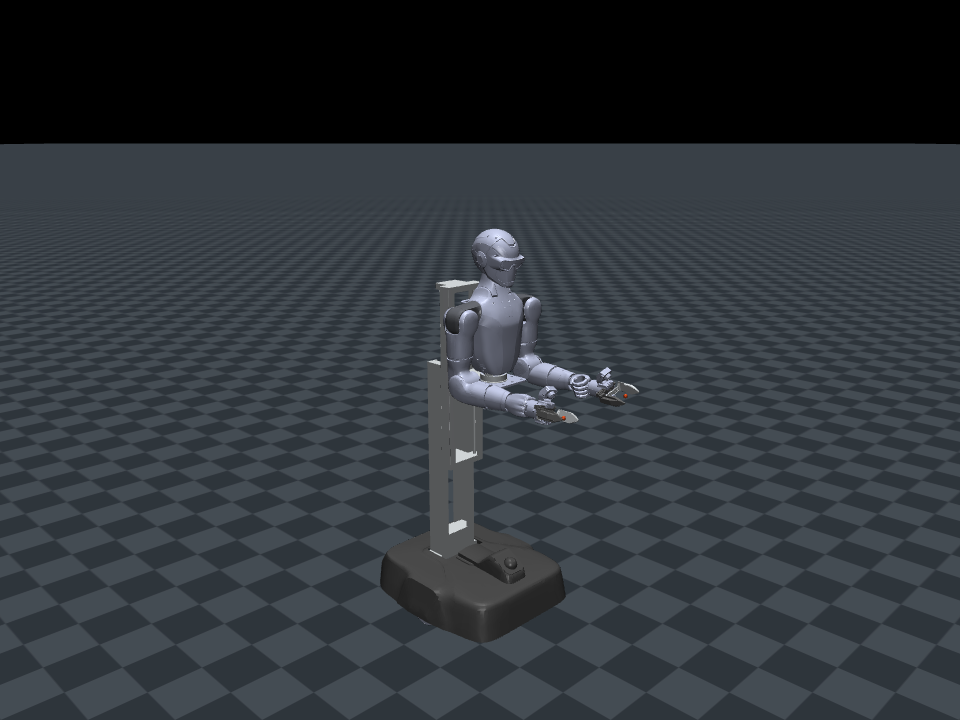

# R1-A5-D + 双 Dex1-1 MuJoCo 仿真

本仓库在 [unitreerobotics/unitree_mujoco](https://github.com/unitreerobotics/unitree_mujoco)
上游提交 `1eb6642e3f3fdfb7fb13a9794fd6a2dd93ea0e7d` 的基础上增加 R1-A5-D 模型、
Python 启动器和 HG DDS 适配。机器人型号为 R1-A5-D，配置左右各一个 Dex1-1 夹爪。

模型源文件、运行代码、测试和所需的 33 个网格文件均保存在当前仓库内。
唯一组装来源为 `unitree_robots/r1_a5_d/source/r1_a5_d.urdf.xacro`：
官方 R1-D 底盘／升降柱、A5 上身／每侧五轴手臂、完整 Dex1-1 夹爪及相机外形。
官方部件来自 `unitree_ros` 提交 `4005a1b0c3f464f515f380be4145cc617fbca725`。
这是组装的仿真模型，安装偏移和动力学未针对实机标定。

## 直接启动

以下所有命令均在 **`unitree_mujoco` 仓库根目录**执行。
首次安装需要 Python 3.12、venv、Git、CMake 和 C/C++ 编译器，以及下载依赖的网络连接：

```bash
./simulate_python/r1_a5_d/setup.sh
```

安装脚本在本仓库创建 `.venv-r1-a5-d`，将固定版本的 DDS／SDK 依赖放入 `.deps/`。
这两个目录已加入 Git 忽略规则。

```bash
# 打开交互窗口，自动演示双腕及双夹爪
./simulate_python/r1_a5_d/run.sh --demo

# 静态保持，可用 MuJoCo 窗口查看关节和执行器
./simulate_python/r1_a5_d/run.sh

# 无窗口离线运行 5 秒仿真时间
./simulate_python/r1_a5_d/run.sh --headless --demo --duration 5

# 实验性自由底盘：轮子与脚轮接触地面
./simulate_python/r1_a5_d/run.sh --mobile
```

默认固定底盘，便于手臂和夹爪开发；升降柱每级初始伸出 0.25 m。
双指和双级升降柱分别使用 1:1 equality 约束。仿真含 29 个标量关节、
21 个执行器、40 个 body（含 world）、3 个联动约束；自由底盘另增加 free joint。
默认保持控制使用位置 PD 和仿真重力补偿；`--demo` 不初始化 DDS。

## DDS 控制演示

终端 1：

```bash
./simulate_python/r1_a5_d/run.sh --dds
```

终端 2：

```bash
./simulate_python/r1_a5_d/client.sh --duration 5
```

两端固定使用 **`lo`、DDS Domain 1**。客户端等待有效仿真状态后发送完整 HG 35 槽
`rt/lowcmd`，保持其他受支持关节，摆动右腕并独立控制左右夹爪。
仿真发布 HG `rt/lowstate`，包含 CRC、tick、关节反馈及理想 IMU；
`mode_machine=10`，只接收 `mode_pr=0`。状态与命令均使用 SDK 自带 CRC。

专用桥接按关节名称查找 MuJoCo 索引：

| HG 槽 | 仿真关节 |
| --- | --- |
| 13 | 腰 yaw |
| 15–19 | 左肩 pitch／roll／yaw、肘、腕 roll |
| 22–26 | 右肩 pitch／roll／yaw、肘、腕 roll |
| 29、30 | 头 pitch、yaw |
| 31、33 | 左、右 Dex1-1，各驱动一对联动手指 |

未映射槽位状态保持零；0、1、12 的轮子和升降柱原始命令语义未确认，因此没有接到
LowCmd；这些机构由本地保持控制管理。左夹爪槽 31 是现有工程的参考映射。
`rt/arm_sdk`、`rt/cmd_vel`、独立 `rt/dex1/...`、相机视频、雷达和高层 RPC 未实现。

手臂执行器计算 `tau + kp*(q_target-q) + kd*(dq_target-dq)`，力矩按源 URDF effort 限幅。
夹爪将原始 q `[0,5.4]` 线性映射为单指行程 `[0,0.041] m`，q 越大越张开，
速度和广义力按同一比例变换，并在双指间分摊。该换算用于仿真，尚无本机毫米标定；
夹爪力反馈也不是实机夹持力标定。PD 使用 MuJoCo affine actuator，让 implicitfast
处理速度阻尼。命令 mode=0 撤销对应受支持轴的驱动力。

250 ms 无有效命令后，仿真切换为当前位置保持并加重力补偿。
此行为由本地模拟器实现，不代表机器人固件的失联行为。
物理步长 2 ms（仿真时间 500 Hz）；有窗口／DDS 时按墙钟节拍运行，实际速率取决于主机负载。

本机 CycloneDDS 0.10.2 在输出 SDK 的 config tracing mask 时会在
`do_print_uint32_bitset` 崩溃。`dds_bridge.initialize_dds()` 在当前进程内提供无 tracing 的
回环单播配置，未修改共享 SDK 或 DDS 库；自定义仿真客户端也应调用该初始化函数。

## 工程结构与重建

```text
unitree_mujoco/
├── R1_A5_D.zh-CN.md                 # 本说明
├── simulate_python/
│   ├── r1_a5_d.py                   # Python 入口
│   └── r1_a5_d/                     # 仿真、DDS、安装脚本、测试与验证记录
├── unitree_robots/r1_a5_d/
│   ├── scene.xml                   # 固定底盘
│   ├── scene_mobile.xml            # 自由底盘
│   ├── source/                     # 组装描述与部件来源
│   ├── meshes/                     # 仓库内的官方部件网格
│   ├── model_sources.json          # 模型及网格 SHA-256
│   └── LICENSE_UNITREE             # 官方部件许可证
├── .venv-r1-a5-d/                   # 本地 Python 环境，不提交
└── .deps/                          # 本地 DDS／SDK 依赖，不提交
```

该型号使用专用启动器。上游通用 Python／C++ 桥接的执行器顺序不等于 A5-D 的稀疏槽位，
只修改上游 `config.py` 或 `config.yaml` 的机器人名称不能获得正确的控制映射。
也可直接使用 Python 入口：

```bash
.venv-r1-a5-d/bin/python simulate_python/r1_a5_d.py --demo

# 从仓库内的源描述重新生成两个 MJCF 场景和来源清单
.venv-r1-a5-d/bin/python simulate_python/r1_a5_d/build_model.py
```

`setup.sh` 默认安装 CycloneDDS 0.10.2（提交
`9995905bce6c4cf9f740d6438bbf7fcfd1c83dfd`）和 Unitree SDK2 Python（提交
`814556d15970dd2ecf1c9984e845ca02ab07e206`）。如需复用已经安装的依赖，可在执行
安装脚本前设置 `CYCLONEDDS_HOME` 和 `UNITREE_SDK2PY_SRC` 为对应的绝对路径；
SDK 源码的提交必须匹配上述版本。运行脚本也支持 `CYCLONEDDS_HOME` 和
`R1_MUJOCO_PYTHON`，后者用于选择已有 Python 解释器。

本型号的代码、模型和网格均为普通仓库文件，可以随 Git 克隆。
官方部件的原始路径及校验值作为历史来源保留在
`unitree_robots/r1_a5_d/source/assembly_sources.json`，运行和重建均读取仓库内文件。
部件许可证见 `unitree_robots/r1_a5_d/LICENSE_UNITREE`；仿真器许可证见仓库根目录 `LICENSE`。

URDF 转换保留 link frame、完整惯量、关节轴和位置限位；使用 `eulerseq="XYZ"` 对齐
[MuJoCo 官方文档中的 URDF RPY 约定](https://mujoco.readthedocs.io/en/3.3.7/XMLreference.html#compiler-eulerseq)。
轮子、脚轮和指尖接触使用简化几何；其他外观网格没有碰撞。
当前验证范围为关节／夹爪运动、基本地面接触及 DDS 联调，未验证整机避碰或稳定抓取。
URDF velocity 字段没有作为电机速度闭环约束，摩擦、传动、时延、接触材料及传感器噪声均未标定。

## 验证和预览

```bash
.venv-r1-a5-d/bin/python -m unittest discover -s simulate_python/r1_a5_d/tests -v
.venv-r1-a5-d/bin/python simulate_python/r1_a5_d/tests/dds_roundtrip.py

MUJOCO_GL=egl ./simulate_python/r1_a5_d/run.sh --headless --demo --duration 5 \
  --render simulate_python/r1_a5_d/evidence/preview.png \
  --report simulate_python/r1_a5_d/evidence/offline-demo.json
```

已通过 4 项自动测试：非零姿态 FK、质量／质心／惯量与轴限位对齐；双夹爪独立开合及双指联动；
稀疏槽路由、非法值、失联保持和禁用；CRC／型号拒收及最新命令队列。
另完成两个独立进程的 HG DDS 往返测试，以及 5 秒固定底盘演示、10 秒自由底盘落地保持，
均无 MuJoCo warning。验证记录位于 `simulate_python/r1_a5_d/evidence/`，包括 `tests.log`、`dds-client.json`、
`dds-server.json`、`dds-roundtrip.log` 和 `validation.json`。


